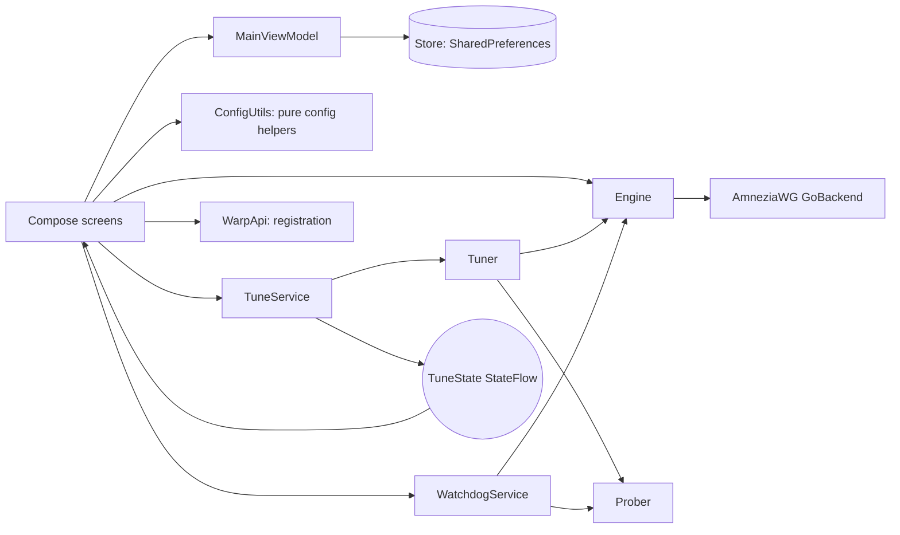

# WarpTuner

Android app (Kotlin, Jetpack Compose) that registers a free Cloudflare WARP device and **tunes AmneziaWG obfuscation parameters and endpoints for the user's own network**.

## Why this project exists

In some networks a plain WARP/WireGuard handshake is throttled or blocked. AmneziaWG adds junk-packet obfuscation (`Jc`, `Jmin`, `Jmax`), but the values that work depend on the ISP and change over time. Trying them by hand is slow and noisy: Wi-Fi speed drifts between runs, so "it feels faster" proves nothing. WarpTuner automates registration, parameter search and verification, and keeps the tunnel healthy afterwards. It was built to solve this problem for the author and friends.

## Download

Signed APKs are published in [Releases](https://github.com/Nikiiita2007/WarpTuner/releases). New releases are built and signed by GitHub Actions and include the APK SHA-256, the signing certificate fingerprint and a build provenance attestation. Verify the file before installing it: see [docs/VERIFY.md](docs/VERIFY.md).

## Features

- Registers a free WARP device through Cloudflare's client API; if the API is unreachable, retries through an already saved config.
- Background tuning (foreground service, notification with a Stop button) that survives minimizing the app; the last result is persisted.
- Search over `Jc/Jmin/Jmax` (random sampling, then mutation of the best candidates) with a repeated measurement of the finalists and of the user's current config.
- Endpoint comparison with paired measurements (reference config vs. candidate, same round) to cancel Wi-Fi drift.
- Tunnel watchdog: checks `warp=on` periodically, reconnects, then falls back to reserve configs from the last tuning.
- Per-app split tunneling (exclude apps or include only selected apps).
- Config import from clipboard, `.conf` file or QR code; first-run onboarding; battery-optimization hint.
- Tuning modes: fast, normal, thorough.

## Screenshots

<!-- TODO: add screenshots to docs/screenshots and reference them here -->

## Architecture

| Part | Responsibility |
|---|---|
| `MainActivity.kt`, `AppRoot.kt` | Activity entry point, edge-to-edge root layout |
| `MainViewModel.kt`, `MainViewModelConfig.kt` | Screen state and user actions (connect, disconnect, account creation, config edits) |
| `MainScreen.kt`, `SettingsScreen.kt`, `AppsScreen.kt`, `OnboardingScreen.kt`, `Components.kt` | Compose screens |
| `MainPreferences.kt`, `SettingsStore.kt` | Settings boundary used by the ViewModel (in-memory fake in tests) |
| `TuningHistory.kt` | Local history of the last 20 completed tuning sessions |
| `Engine.kt` | Wrapper around the AmneziaWG `GoBackend`: up, down, state, trace |
| `ConfigUtils.kt` | Pure config helpers: build config, extract template, split-tunnel lines, validation (unit tested) |
| `Tuner.kt` | `Prober` (trace, site reachability, speed, scoring) and `Tuner` (search strategy) |
| `TuneService.kt` | Foreground service that runs a tuning session and publishes `TuneState` |
| `WatchdogService.kt` | Foreground service that monitors the tunnel and fails over |
| `TuneState.kt` | Shared UI state and JSON (de)serialization of results |
| `Warp.kt` | `Store` (preferences, secrets encrypted), `WarpApi` (registration), account creation |
| `SecretBox.kt` | AES-256-GCM codec and Android Keystore key for secrets at rest (unit tested) |
| `Clipboard.kt` | Sensitive clipboard copy and delayed clearing |

## How candidates are scored

`score = 100 * share_of_reachable_sites * (0.4 * min(speed, 50) / 50 + 0.3 * (1 - rtt / 1000) + 0.3 * (1 - loss))`

Speed is a short download through the tunnel, RTT is the median of repeated `trace` requests, loss is the share of failed requests, and reachability covers YouTube, Telegram and Telegram Web. Finalists and the user's current config are measured twice and averaged, because single measurements fluctuate a lot.

## Build and run

Requirements: Android Studio (recent stable), JDK 17 or newer (CI uses JDK 21), an Android 8.0+ device (minSdk 26) or emulator; Google Play services are needed for QR scanning.

1. Clone the repository and open it in Android Studio.
2. Let Gradle sync finish (see `app/build.gradle.kts` for dependencies).
3. Run the `app` configuration on a device (USB debugging) or build a debug APK with `./gradlew assembleDebug`.
4. Run unit tests with `./gradlew testDebugUnitTest`.

Release signing keys are never stored in the repository. See [CONTRIBUTING.md](CONTRIBUTING.md) for the full development workflow and [SECURITY.md](SECURITY.md) for reporting vulnerabilities.

## Dependencies and licenses

- AmneziaWG tunnel library [`com.zaneschepke:amneziawg-android`](https://central.sonatype.com/artifact/com.zaneschepke/amneziawg-android) (Maven Central), Apache License 2.0.
- Google code scanner (`com.google.android.gms:play-services-code-scanner`) for QR import, subject to Google Play services terms.
- AndroidX and Jetpack Compose libraries, Apache License 2.0.

## Network requests and privacy

The app talks only to: `api.cloudflareclient.com` (registration), `www.cloudflare.com/cdn-cgi/trace`, `speed.cloudflare.com`, `www.youtube.com`, `api.telegram.org` and `web.telegram.org` (reachability checks). There is no analytics, advertising or crash-reporting SDK. The WARP private key, account data and configs are encrypted in the app's private storage with an AES-256-GCM key held in the Android Keystore, and are excluded from Android backups and device transfer. Only HTTPS is allowed and user-installed certificates are not trusted. Copied configs are hidden from the clipboard preview (Android 13+) and cleared after 60 seconds.

## Design decisions and trade-offs

- **One tunnel at a time.** Android allows a single active VPN, so candidates are measured sequentially. Speed is gained by cheaper measurements and fewer candidates, not by parallelism.
- **Paired measurements instead of absolute numbers.** Absolute speed depends on the moment; the ratio to a reference measured in the same round is much more stable.
- **No automatic re-tuning.** The watchdog only reconnects or switches to reserve configs; a full tuning drops the tunnel and uses traffic, so the user decides.
- **Foreground services.** Long tuning and monitoring need to survive backgrounding; this costs a persistent notification.

## Known limitations

- Registration relies on Cloudflare's unofficial client API and may stop working at any time.
- The `vpn://` import format of the Amnezia client is not supported, only plain `.conf` text.
- The QR scanner depends on Google Play services.
- The GitHub repository the tunnel library was forked from (`wgtunnel/amneziawg-android`) is archived, so watch the Maven Central artifact for updates.
- If the Android Keystore is unusable on a device, secrets fall back to plain app-private preferences so the app keeps working.

## Roadmap

- [x] Extract `Engine` and config helpers from `MainActivity.kt`
- [x] Unit tests for `Tuner` helpers, `Prober.score`, result JSON and config helpers
- [x] ViewModel, screens split into separate files, preferences injected through a factory
- [x] Local storage of completed tuning sessions
- [ ] Tuning history screen with network type, diagnostic log export
- [x] Encrypted storage of the private key (Android Keystore)
- [x] Signed release built by CI with published SHA-256, signing certificate fingerprint and provenance
- [ ] Update check against GitHub Releases

## Disclaimer

Unofficial project, not affiliated with Cloudflare or the Amnezia project. Check the terms of the services you use.

## License

MIT, see [LICENSE](LICENSE). Third-party libraries keep their own licenses (see "Dependencies and licenses").
